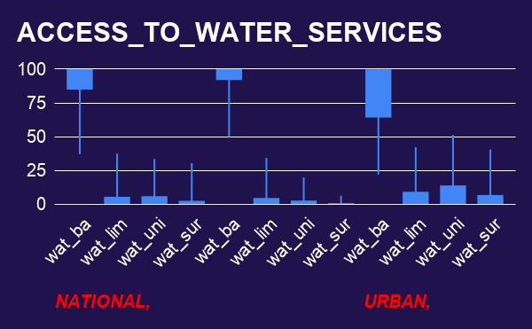

# water-access-analysis-WHO-UNICEF-2020
# 🚰 Global Drinking Water Access: Exploratory Data Analysis

<!-- Visual Banner: Displays automatically once you save your dashboard file to the images folder -->

## 📋 Executive Summary
*   **The Mission:** Investigated global water infrastructure distribution across countries to uncover critical access disparities based on geographic urbanization and country-level economic classes.
*   **The Data Mass:** Audited, validated, and analyzed a comprehensive global dataset representing **99.56% of the estimated 2020 world population** (~7.78 billion lives).
*   **The Core Impact:** Built an interactive analytical framework that transitions static population indicators into dynamic, stakeholder-oriented insights for targeted resource deployment.

---

## 🎯 The Core Business Problem
*   **The Question:** Do different geographic and economic populations have safe, equitable access to clean drinking water—and what specific structural disparities does macro-aggregation hide?
*   **The Challenge:** Traditional baseline reporting treats global populations as uniform blocks. This analysis explicitly breaks apart national averages to expose the hidden infrastructural gaps between thriving urban centers and vulnerable rural networks.

---

## 📊 Dataset & Architecture Under the Hood
*   **Primary Source:** WHO/UNICEF Joint Monitoring Programme (JMP) 2020 Global Report.
*   **Data Volume:** 16 critical columns mapped across global country observations.
*   **Key Parameters Utilized:** 
    *   `pop_n` / `pop_u` / `pop_r`: National population mass, urban percentages, and derived rural distributions.
    *   `income_group`: Categorical World Bank structural economic indexing.
    *   `wat_bas_*` / `wat_lim_*` / `wat_unimp_*` / `wat_sur_*`: 12 granular water-service delivery columns split across National, Urban, and Rural layers.

---

## 💡 Top Strategic Insights & Findings

### 1. The Spatial Infrastructure Divide
*   **Urban Dominance:** Urban centers showcase highly insulated, stable basic water access tightly concentrated near maximum thresholds.
*   **Rural Volatility:** Rural populations display extensive statistical variation (IQR = 5.25 for unimproved water) and a massive reliance on lower-tier water solutions, proving that spatial geography is the primary indicator of local water service quality.

### 2. Macroeconomic Progression Matrix
*   **The Income Axis:** Basic water access climbs flawlessly across ascending economic tiers: **62.82% (Low) → 82.21% (Lower-Middle) → 96.43% (Upper-Middle) → 99.56% (High)**.
*   **The Lower-Middle-Income Window:** Lower-middle-income territories house the largest collective human segment in this study (over 3.39 billion lives) but remain 18% behind high-income access baselines. **This represents the single highest-yield deployment zone for structural infrastructure investment.**

---

## 🛠️ Technical Process & Data Engineering

### 1. Integrity Verification & Data Cleaning
*   **Volumetric Auditing:** Deployed `=COUNTA()` mapping arrays to flag malformed 15-column fields, separating strings safely via **Split Text to Columns** to resolve hidden semicolon errors.
*   **Precision Guardrails:** Isolated math errors by cleaning precision rounding anomalies (handling an impossible `100.0000037%` entry down to `100%` objectively using `=ROUND()`).
*   **Missing Value Strategy:** Segregated active `#VALUE!` strings to ensure raw missing value states (`NaN`) were never miscalculated as true `0%` metrics.

### 2. Statistical Analysis & Feature Engineering
*   **Feature Design:** Engineered the baseline demographic attribute `pop_r` (`=100 - pop_u`) to achieve absolute structural balance across datasets.
*   **Spread Modeling:** Calculated Mean vs. Median negative skew variances alongside Standard Deviation thresholds to monitor extreme country-level outliers.
*   **Scale Optimization:** Resolved visual overcrowding on column charts by aggregating individual nations into rounded population categories via `=ROUNDUP(C2/1000,0)` and applying unweighted group averages.
*   **Ordinal Class Coding:** Built a nested `=IF()` logic array to transition categorical economic tiers into ordered numeric indexing parameters (0 → 4) for structured pivot table matrix groupings.

---

## 💻 Tech Stack & Analytical Skillset
*   **Core Tool:** Google Sheets
*   **Key Operations:** Pivot Table Matrix Structuring, Ordinal Category Coding, Nested Conditionals.
*   **Statistical Application:** Descriptive Analysis, Central Tendency Calculations, Five-Number Summaries, Box-and-Whisker Candlestick Distributions.

---

## 📂 Repository Blueprint
*   📂 `data/` ── Holds raw data reference profiles and standardized, cleaned analysis matrices.
*   📂 `notebooks/` ── Main directory for documentation scratchpads and formula logic testing.
*   📂 `reports/` ── Contains executive-ready summary presentations and data documentation deliverables.
*   📂 `images/` ── Architecture workflows, candlestick chart files, and dashboard interface screenshots.

---

## 👤 Technical Analyst Contact
**Ayomide Yaya**  
*Data Analyst & Digital Systems Consultant*  
Founder, Pinsight Digital Systems Lab  
📧 [yayaayomide17@gmail.com](mailto:yayaayomide17@gmail.com)  
🔗 [LinkedIn Profile](https://linkedin.com)
